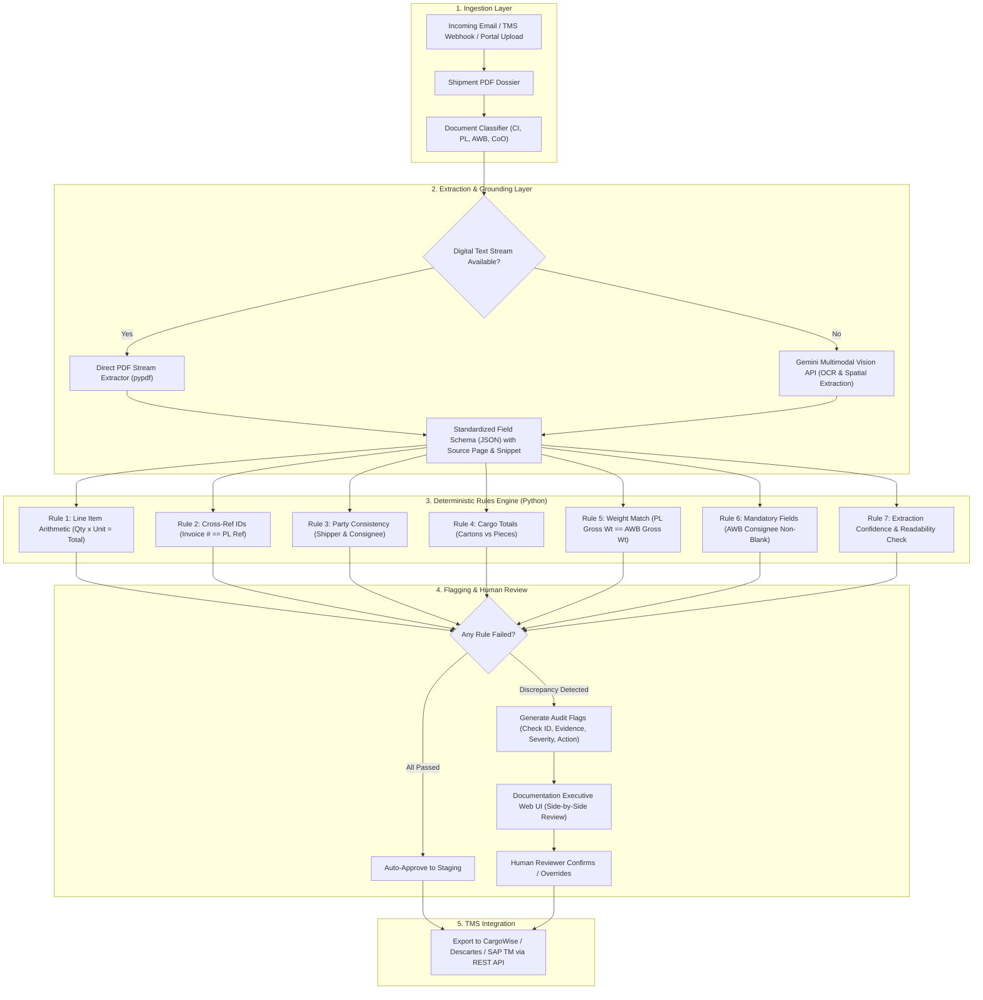

# AI Documentation Executive - Intelligent Freight Forwarding Audit Engine

[](https://github.com/)
[](https://github.com/)
[](https://python.org)
[](https://ai.google.dev/)

An autonomous, audit-grade verification engine designed for freight forwarders and logistics operations. The system automates cross-document validation across **Commercial Invoices**, **Packing Lists**, and **Air Waybills (AWB)**, detecting discrepancies, preventing customs holds, and replacing slow manual document checks with a sub-minute, human-in-the-loop review workflow.

---

## 1. Executive Problem Statement

In global freight forwarding, moving cargo requires a multi-party **Shipment Dossier** (Commercial Invoice, Packing List, Air Waybill or Bill of Lading, Certificate of Origin, Dangerous Goods declarations).

```
   ┌──────────────────────┐      ┌───────────────────┐      ┌─────────────────────┐
   │  Commercial Invoice  │      │   Packing List    │      │     Air Waybill     │
   │  (Valuation & Terms) │      │  (Weights & Pkgs) │      │  (Carrier Contract) │
   └──────────┬───────────┘      └─────────┬─────────┘      └──────────┬──────────┘
              │                            │                           │
              └─────────────────────┐      │      ┌────────────────────┘
                                    ▼      ▼      ▼
                        ┌─────────────────────────────────────┐
                        │   Manual Cross-Check (15-45 mins)   │
                        │     High Risk of Human Error        │
                        └──────────────────┬──────────────────┘
                                           │
         ┌─────────────────────────────────┴─────────────────────────────────┐
         ▼                                 ▼                                 ▼
┌──────────────────┐             ┌────────────────────┐            ┌────────────────────┐
│ Customs Holds &  │             │ Airline Rejections │            │ Letter of Credit   │
│ Demurrage Fines  │             │ at Cargo Cutoff    │            │ Payment Delays     │
└──────────────────┘             └────────────────────┘            └────────────────────┘
```

### The Operational Bottlenecks:
1. **Manual Inspection Fatigue**: Human freight clerks spend **15 to 45 minutes per shipment** cross-referencing fields across heterogeneous PDFs.
2. **Expensive Discrepancies**:
   - **Customs & Demurrage Fines**: An AWB gross weight of $254\text{ kg}$ vs a Packing List declaring $245\text{ kg}$ causes cargo holds, triggering port storage and demurrage fees (\$150–\$500/day).
   - **Tender Rejection**: A piece count discrepancy (11 pieces vs 12 cartons) causes ground handling agents to reject cargo at the airline cutoff.
   - **Trade Finance Non-Compliance**: Mismatches in consignee names or invoice reference numbers cause banks to reject Letter of Credit (L/C) settlements.
3. **Linear Scaling**: Forwarder operations require more back-office staff for every incremental shipment handled.

---

## 2. Real-World Challenges with Freight Forwarders

Deploying AI into real-world freight forwarding introduces strict operational constraints that cannot be solved by generic chat prompts:

| Challenge Area | Real-World Reality | System Solution |
| :--- | :--- | :--- |
| **Document Degradation** | Faxes, skewed smartphone photos, 150-DPI scans, stamps covering totals. | Dual-mode pipeline: direct vector parsing for digital PDFs; Gemini Multimodal Vision API for scanned pages. |
| **Non-Standard Layouts** | Every exporter uses a custom invoice format (`G.W. (KGS)` vs `Gross Mass`). | Schema normalization into a strict, strongly-typed JSON intermediate representation. |
| **Entity Fuzzy Matching** | Corporate names vary (`DEMO CARGO FZE` vs `Demo Cargo Free Zone Establishment`). | Semantic token normalization with client-defined tolerance thresholds. |
| **Zero-Hallucination Mandate** | Guessing values is a customs violation with legal liability. | Strict `unreadable/uncertain` fallback; whenever confidence is low, escalate to human review. |
| **Human-in-the-Loop** | AI cannot legally sign a customs declaration or assume carriage liability. | The engine flags discrepancies with source page references, snippets, and recommended actions for 1-click human verification. |

---

## 3. Technology Stack & API Configuration

* **Runtime**: Python 3.12+ (managed via `uv`)
* **Vision / LLM Layer**: **Google Gemini (`gemini-3.8-flash` / `gemini-3.1-pro`)**
  * Natively ingests multi-page documents without brittle external OCR pre-processing.
  * Spatial table extraction and bounding-box level grounding.
* **Environment Credentials**:
  * Set in `.env`:
    ```bash
    GOOGLE_API_KEY="your-gemini-api-key"
    GEMINI_API_KEY="your-gemini-api-key"
    ```
* **Deterministic Logic**: Pure Python arithmetic and strict cross-field validation rules (eliminating LLM hallucination from mathematical checks).

---

## 4. End-to-End System Architecture



---

## 5. Configured Verification Checklist

The system implements the 7 core checks defined in [`FIELD_CHECKLIST.md`](file:///C:/Users/HP/AGENTIC%20AI%20BOOTCAMP/freight-prototype/FIELD_CHECKLIST.md):

1. **`CHK-ARITHMETIC-001` (Line Item Arithmetic)**:
   $$\text{Quantity} \times \text{Unit Value} == \text{Line Subtotal}$$
   Verified using high-precision Decimal arithmetic (e.g., $240 \times \$25.00 = \$6,000.00$).
2. **`CHK-INVOICE-REF-002` (Cross-Document Reference)**:
   The Packing List's referenced invoice number must match the Commercial Invoice number (`DEMO-INV-1001`).
3. **`CHK-CONSIGNEE-003` (Party Name Consistency)**:
   Shipper and Consignee names must match consistently across all three documents.
4. **`CHK-PIECES-004` (Carton vs Piece Ratio)**:
   Packing list package count must match AWB piece count under the shipment's agreed packaging rule (12 cartons = 12 pieces).
5. **`CHK-GROSS-WEIGHT-005` (Gross Weight Alignment)**:
   Packing-list gross weight must equal the AWB gross weight (245 kg).
6. **`CHK-CONSIGNEE-REQUIRED-006` (Mandatory Consignee Check)**:
   The AWB consignee field is mandatory and must not be blank or omitted.
7. **`CHK-READABILITY-007` (Extraction Confidence & Fallback)**:
   If text is degraded or unreadable, the engine marks the field `uncertain` and requests human review—never guessing.

---

## 6. How to Run the Prototype

### Prerequisites
Make sure dependencies are installed via `uv`:
```bash
uv pip install pypdf
```

### Launch the Interactive Streamlit UI Dashboard

To launch the Human-in-the-Loop web interface:

```bash
uv run streamlit run freight-prototype/app.py
```
*(Or if you are already inside `freight-prototype`, run `uv run streamlit run app.py`)*

Then open **`http://localhost:8501`** in your browser.

---

### Execute via Command-Line (Headless CLI)

**Option A — If you are in the workspace root (`AGENTIC AI BOOTCAMP`):**
```bash
uv run python freight-prototype/run_checklist.py
```

**Option B — If you are already inside the `freight-prototype` folder:**
```bash
uv run python run_checklist.py
```

### Sample Output:
```json
{
  "status": "PASS",
  "total_checks": 7,
  "passed_checks": 7,
  "failed_checks": 0,
  "extracted_data": {
    "commercial_invoice": { "invoice_number": "DEMO-INV-1001", "line_total_usd": 6000.0 },
    "packing_list": { "invoice_reference": "DEMO-INV-1001", "gross_weight_kg": 245.0 },
    "air_waybill": { "awb_number": "DEMO-AWB-1001", "gross_weight_kg": 245.0 }
  },
  "flags": []
}
```

---

## 7. Repository Layout

```
freight-prototype/
├── README.md                      # Complete Project Documentation & Architecture (this file)
├── FIELD_CHECKLIST.md             # The official extraction schema & rules checklist
├── EXPECTED_RESULTS.json          # Benchmark validation suite for all test cases
├── GROUND_TRUTH.json              # Canonical ground truth data points
├── SYNTHETIC_DATASET_GUIDE.md     # Reference guide for synthetic test pack cases
├── AUDIT_REPORT.md                # Human-readable markdown audit summary
├── run_checklist.py               # Deterministic parsing and checklist audit engine
├── demo_commercial_invoice_clean.pdf
├── demo_packing_list_clean.pdf
└── demo_air_waybill_clean.pdf
```

---

## 8. Disclaimer
*All records, companies, carrier names, and numbers in these files are synthetic and fictional for software demonstration purposes only. They are not valid for actual transport, customs clearance, banking, or regulatory filings.*
